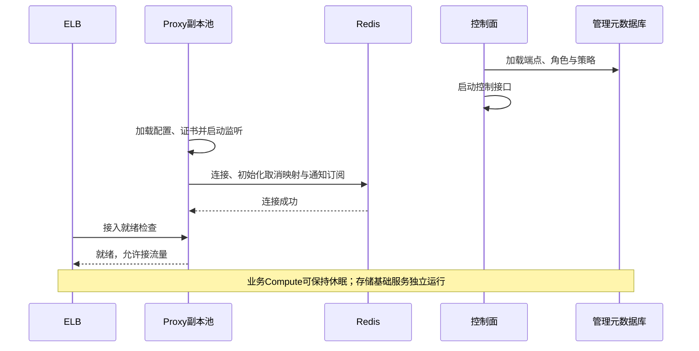
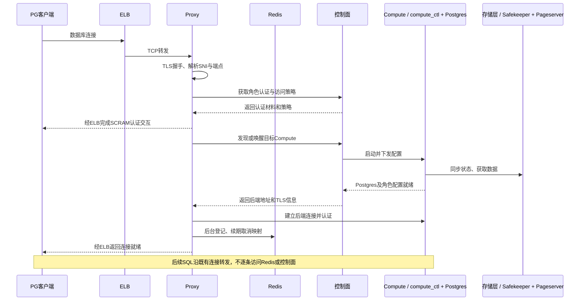
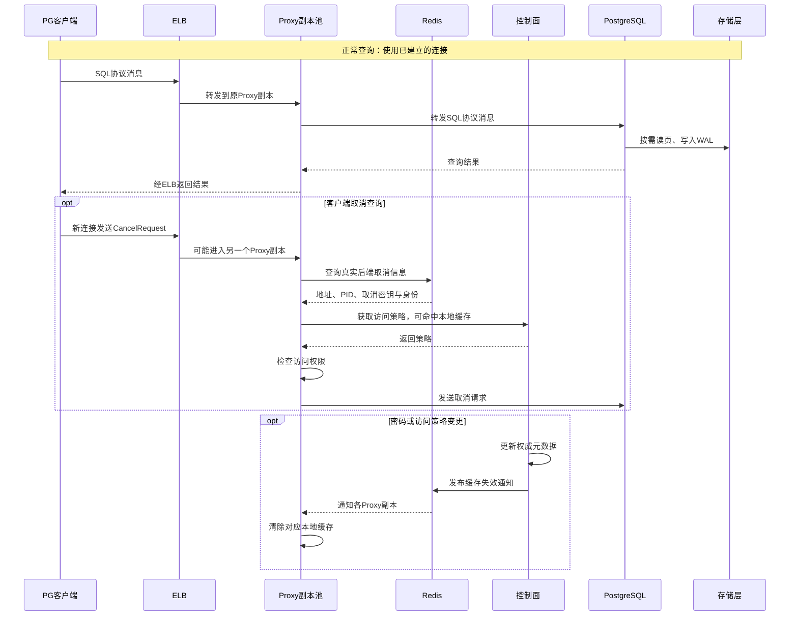

# Neon Proxy：启动、Compute 唤醒与运行期协作

本文用三张时序图说明 Neon Proxy 在整个服务端中的生命周期：平台启动、客户端连接与 Compute 唤醒、正常查询及运行期协作。

本文依据 Neon 开源代码版本 [`fa504217c61bbcaf5c512d75830564541f917f8f`](https://github.com/neondatabase/neon/tree/fa504217c61bbcaf5c512d75830564541f917f8f)，整理于 2026-10-27。平台编排与 ELB 就绪检查属于自建服务的部署设计，不能等同于 Neon 或 Databricks Lakebase 生产环境的完整编排。

## 组件与职责

| 组件 | 定位与职责 |
|---|---|
| PostgreSQL 客户端 | 使用 psql、JDBC、pgx、psycopg 等原生驱动连接 |
| ELB / TCP 负载均衡器 | 提供稳定入口，将每条 TCP 连接转发到一个就绪的 Proxy 副本 |
| Proxy 副本池 | TLS、身份认证、端点发现、后端建连、会话转发与查询取消 |
| Redis | 共享取消映射，并通过 Pub/Sub 通知 Proxy 清除认证和访问策略缓存 |
| 控制面 | 维护端点、身份与访问策略，协调 Compute 启动及恢复 |
| 管理元数据库 | 保存控制面的权威元数据，与业务 Compute 的生命周期独立 |
| Compute / compute_ctl | 准备配置与基础数据，启动 Postgres，配置角色和数据库 |
| PostgreSQL | 解析和执行 SQL，管理事务、锁、MVCC 与会话 |
| 存储层 | Safekeepers 持久化 WAL，Pageserver 提供数据页，对象存储保存长期数据 |

## 阶段一：平台与 Proxy 启动

先启动管理元数据库、Redis 和存储基础服务，再准备控制面及 Proxy 接入层。业务 Compute 可以保持休眠。

需要区分“进程启动”“端口可连接”和“接入就绪”：

- 当前版本先启动监听任务，再完成 Redis 初始化；不能只用端口打开作为完整就绪判断。
- Redis 连接成功后，缓存失效订阅以异步任务运行，不能把服务 running 状态等同于订阅已成功。
- 图中的 ELB 接入就绪检查需要在部署侧补齐。源码中的 `/v1/status` 固定返回 HTTP 200，不检查 Redis、控制面或所有业务数据库。
- 就绪检查不应要求所有业务 Compute 都已运行，否则会与休眠设计冲突。
- ELB 使用 TCP 转发、TLS 在 Proxy 终止时，客户端的 TLS 与 SNI 可以到达 Proxy。若启用 PROXY protocol v2，负载均衡器与 Proxy 的配置必须一致。

## 阶段二：客户端连接并唤醒 Compute

Proxy 从控制面获取认证材料及后端地址。目标 Compute 休眠时，由控制面协调启动；Proxy 等待后端可连接，再建立数据库会话。

- 图中控制面调用是缓存未命中时的逻辑路径；命中缓存时可以省略相应远程请求。
- Compute 已运行时，控制面返回其地址，不需要再次启动。
- `compute_ctl` 的准备过程包括存储状态同步、基础数据获取、Postgres 启动和角色配置。进程出现不等同于业务数据库就绪。
- 取消映射的登记和续期是后台工作，图中相邻箭头不表示每次连接都同步等待一次 Redis 写入。
- 客户端响应仍经过 ELB，图中部分返回箭头将中转步骤合并展示。
- 图示为 Direct 路径。Pooled 路径在 Proxy 与 Postgres 之间增加 PgBouncer。

## 阶段三：正常查询与运行期协作

普通 SQL 使用既有 TCP 连接转发；取消查询通过独立连接发送；密码或策略变更通过 Redis 失效通知传播到各 Proxy 副本。

运行期需要注意：

- ELB 为每条连接选择目标；普通查询始终沿原有连接到达同一个 Proxy。取消请求另建连接，因此可能进入不同副本。
- Proxy 向客户端提供代理生成的取消标识，Redis 将其映射到真实后端地址、PID 和取消密钥。在此版本中，同一 Proxy 上的原生取消路径也依赖该映射。
- 发送取消请求不等于查询已经结束，客户端还需观察原查询连接上的取消结果。
- 认证与访问策略缓存主要位于 Proxy 内存；Redis 传递失效事件，权威状态仍在控制面。
- Pub/Sub 不是可靠事件日志，需要结合缓存 TTL、重连恢复或版本校验约束变更生效时间。密码缓存失效也不等于自动终止已有会话。
- 存储访问是按需发生的；命中本地缓存的读请求不需要每次访问 Pageserver，事务提交则涉及 WAL 持久化。

## Compute 与 Proxy 的生命周期

| 状态 | 独立接入层 Proxy | Compute 内的 Postgres、local_proxy、PgBouncer |
|---|---|---|
| Compute 活跃 | 保持接入与转发 | 按相应访问路径提供服务 |
| 整个 Compute 休眠 | 保持运行，接住新连接并协调唤醒 | 随 Compute 停止 |
| Compute 恢复 | 重新发现目标并建立后端连接 | 初始化后重新提供服务 |

这里的 `local_proxy` 是 Compute 内的 HTTP/serverless 配套组件，不是图中的独立原生 PostgreSQL 接入 Proxy。原生 Direct 或 PgBouncer 路径不要求经过 `local_proxy`。

Compute 休眠或故障后，原有连接、事务与会话状态不能由 Proxy 自动恢复。应用需要重连，并正确处理事务结果不确定性。

## 源码参考

- [Proxy 进程启动与任务监督](https://github.com/neondatabase/neon/blob/fa504217c61bbcaf5c512d75830564541f917f8f/proxy/src/binary/proxy.rs)
- [健康与指标接口](https://github.com/neondatabase/neon/blob/fa504217c61bbcaf5c512d75830564541f917f8f/proxy/src/http/health_server.rs)
- [客户端认证与后端连接主流程](https://github.com/neondatabase/neon/blob/fa504217c61bbcaf5c512d75830564541f917f8f/proxy/src/proxy/mod.rs)
- [控制面地址发现与访问控制客户端](https://github.com/neondatabase/neon/blob/fa504217c61bbcaf5c512d75830564541f917f8f/proxy/src/control_plane/client/cplane_proxy_v1.rs)
- [查询取消映射](https://github.com/neondatabase/neon/blob/fa504217c61bbcaf5c512d75830564541f917f8f/proxy/src/cancellation.rs)
- [Redis 缓存失效通知](https://github.com/neondatabase/neon/blob/fa504217c61bbcaf5c512d75830564541f917f8f/proxy/src/redis/notifications.rs)
- [Compute 启动入口](https://github.com/neondatabase/neon/blob/fa504217c61bbcaf5c512d75830564541f917f8f/compute_tools/src/bin/compute_ctl.rs)
