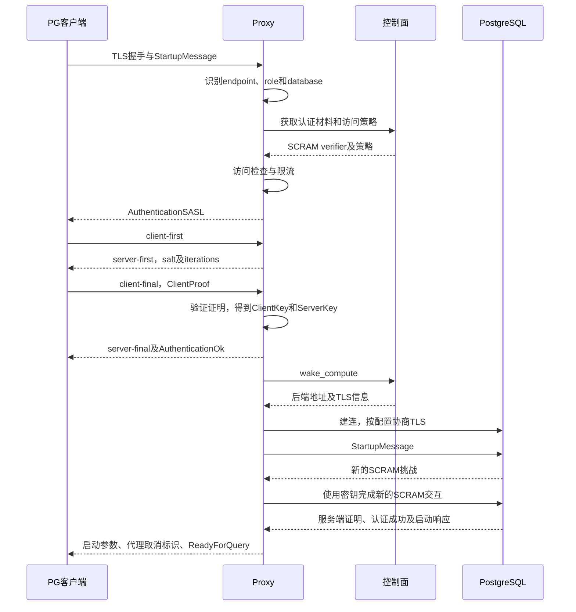

# Neon Proxy 双段认证：客户端到 Proxy，再到 PostgreSQL

Neon Proxy 在原生 PostgreSQL Direct 连接中分别扮演服务端和客户端：先验证前端用户，再以该用户角色登录后端。两段 SCRAM 认证独立进行，但可以复用密钥，无需获取用户明文密码。

本文依据 Neon 开源提交 [`fa504217`](https://github.com/neondatabase/neon/tree/fa504217c61bbcaf5c512d75830564541f917f8f)，整理于 2026-10-29；不涵盖 HTTP/JWT、console redirect 等其他认证路径。

## 角色与凭据

| 连接 | Proxy 的角色 | 认证方式 |
|---|---|---|
| 客户端 → Proxy | PostgreSQL 服务端 | SCRAM-SHA-256，或支持 channel binding 的 SCRAM-SHA-256-PLUS |
| Proxy → PostgreSQL | PostgreSQL 客户端 | 使用前端认证得到的密钥，完成新的 SCRAM 认证 |
| Proxy → 控制面 | 内部 API 客户端 | 独立的服务 Bearer Token，与数据库用户密码无关 |

## 核心机制

控制面向 Proxy 提供访问策略和角色的 SCRAM verifier，结构为：

```text
SCRAM-SHA-256$iterations:salt$StoredKey:ServerKey
```

1. **前端认证**：Proxy 识别 endpoint、role 和 database，获取策略与 verifier，检查访问来源并与客户端完成 SCRAM 交互。
2. **得到密钥**：Proxy 从客户端的 ClientProof 恢复并验证 ClientKey，再结合 verifier 中的 ServerKey，形成后端认证凭据。
3. **后端认证**：Proxy 获取或唤醒 Compute，以用户角色发送 PG 启动消息；使用 ClientKey 和 ServerKey，针对后端的新挑战完成 SCRAM。

这不是转发前端认证消息，也不是重放 ClientProof。Neon 修改的 PostgreSQL 客户端库支持直接使用密钥进行认证。

## 认证时序



控制面请求可以命中 Proxy 缓存；目标 Compute 休眠时，由控制面协调启动。客户端收到 AuthenticationOk 仅表示前端认证通过，收到 ReadyForQuery 才表示后端会话也已就绪。

## 自建服务的关键约束

- **verifier 一致**：控制面与后端角色必须使用匹配的 SCRAM verifier。仅分别设置相同明文密码不够，重新设置密码可能生成不同的 salt。
- **密码更新协调**：同步数据库角色、控制面认证材料与 Proxy 缓存失效，避免新旧状态不一致。
- **后端认证匹配**：此密钥复用路径针对 SCRAM，不能将密钥当作通用明文密码用于其他认证方式。
- **保护认证边界**：Proxy 持有敏感 verifier 和认证密钥；前后端 TLS 分别协商，前端 channel binding 不会原样延伸到后端。
- **权限由数据库执行**：后端以用户角色登录，表、schema 等 SQL 权限仍由 PostgreSQL 检查。前端认证成功不能替代后端认证和授权。

## 源码参考

- [前端认证流程](https://github.com/neondatabase/neon/blob/fa504217c61bbcaf5c512d75830564541f917f8f/proxy/src/auth/flow.rs)
- [SCRAM 证明验证与 ClientKey 恢复](https://github.com/neondatabase/neon/blob/fa504217c61bbcaf5c512d75830564541f917f8f/proxy/src/scram/exchange.rs)
- [后端密钥封装](https://github.com/neondatabase/neon/blob/fa504217c61bbcaf5c512d75830564541f917f8f/proxy/src/auth/backend/classic.rs)
- [后端认证配置](https://github.com/neondatabase/neon/blob/fa504217c61bbcaf5c512d75830564541f917f8f/proxy/src/compute/mod.rs)
- [支持密钥认证的客户端实现](https://github.com/neondatabase/neon/blob/fa504217c61bbcaf5c512d75830564541f917f8f/libs/proxy/postgres-protocol2/src/authentication/sasl.rs)
