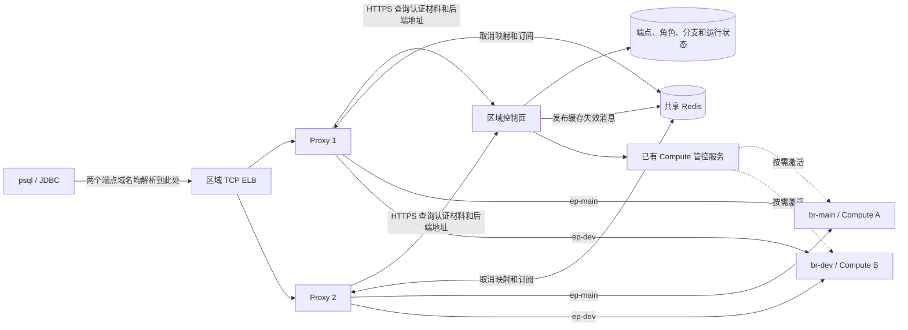
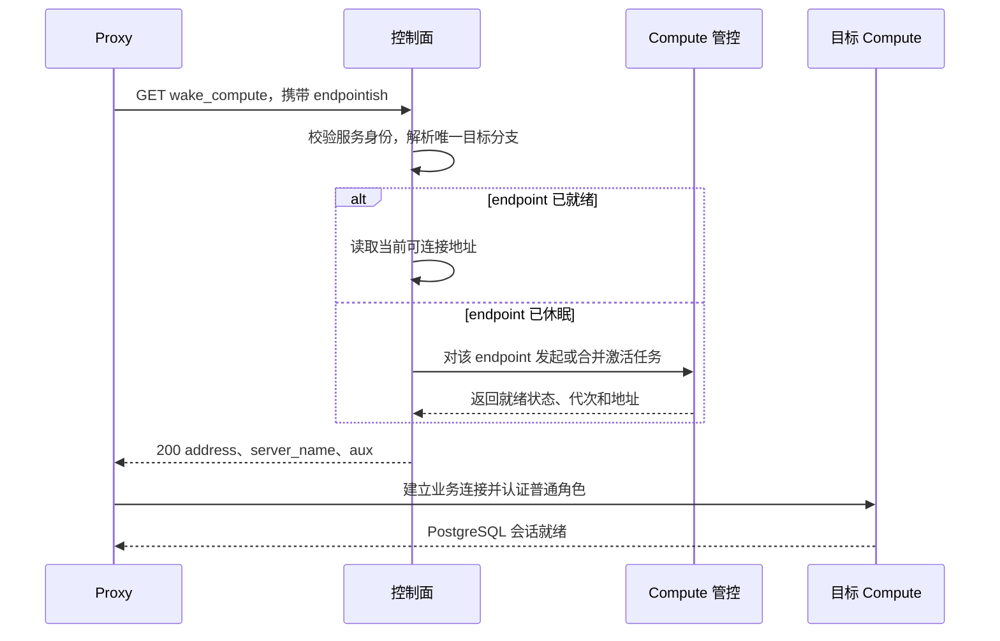

# 云服务新增 PostgreSQL Proxy：部署与管控接口详细设计

## 1. 部署视图：一个区域、一个接入池、两个分支



范围：原生 PostgreSQL、TLS、SCRAM、Direct 连接。两个分支和它们的可写 endpoint 已存在，Compute 允许休眠；本文不涉及安装或启动 Compute 的命令。假设 Linux Proxy 可执行文件已交付。**新增的是区域接入容量**：不在 Compute 注册 Proxy，不给每个 branch 新建 Proxy，也不要求两台 Compute 同时在线。

接口分三层：① **外部资源 API** 和部署状态机是本文给自建平台的设计建议；② **Proxy → 控制面**以及 **Redis → Proxy** 的名称与字段来自 Neon 版本 `fa504217`；③ 控制面如何操作云 ELB 和激活 Compute，由各云适配。当前机器验证过的是 postgres mock 模式；本文云拓扑及命令为部署设计，未做 Linux 云环境端到端实测。

## 2. 场景一：新建区域 Proxy 并加入 ELB

### 2.1 前置条件与执行顺序

| 步骤 | 发起方 → 对端 | 动作与成功条件 |
|---|---|---|
| 1. 校验依赖 | 管控 → DNS、ELB、网络、密钥服务 | 两个 endpoint 域名均指向 ELB；证书覆盖它们。ELB 以四层 TCP 转发，TLS 在 Proxy 终止。开放 ELB → Proxy:4432、Proxy → 控制面 HTTPS、Redis、Compute PG 端口；控制面发布端也能访问 Redis。 |
| 2. 准备路由 | 管控 → 控制面 | 保存 endpoint → project/branch/compute 关系、角色 verifier 和策略；配置 Proxy 服务身份。在云模式 Proxy 无需 rdsProxy 数据库超级用户：此前该用户用于 mock 查系统目录。 |
| 3. 准备共享 Redis | 管控 → Redis | 配置认证、网络、容量和可用性；各副本连同一逻辑 Redis。控制面不依赖 Redis 存放权威密码或分支映射。 |
| 4. 创建副本 | 管控 → Linux 实例或容器 | 下发固定版本二进制、环境文件、证书和密钥，执行下文命令；每个副本独立启动。 |
| 5. 判定就绪 | 发布系统 → 副本 | 验证监听与证书、Redis KV 初始化、订阅建立、控制面认证接口；用专用 canary endpoint 做 SQL 验收。不要为探活唤醒每个业务分支。 |
| 6. 加流量 | 管控 → ELB | 将合格副本注册到 target group，等待 ELB healthy；用两个域名经 ELB 验证路由后标记 Ready。失败副本不接流量，重试该副本；保留旧健康 target。 |

建议按 Pending → Provisioning → Checking → Registering → Ready 记录状态，从任一步进入 Failed 时保留失败阶段。**进程监听不代表依赖就绪**：源码先绑定监听器，再尝试 Redis KV，最多 3 次；失败退出。control-plane 模式随后异步启动 Pub/Sub 订阅。内置 /v1/status 固定返回 200；ELB 可用独立 readiness 探针或由管控决定何时注册，不能仅据端口打开宣布成功。

### 2.2 Linux 配置文件和启动命令

以下均为 Bash。假设已有 proxy、redis-server、redis-cli、openssl、psql；普通用户在自己的目录运行，无需 root。命令给出同机联调默认值；云上须把控制面地址、有效 token、共享 Redis 地址、域名和信任链换成已交付资源。XXXXXXXXXX 是可直接用于演示的字面密码；它不是 SCRAM verifier，也不是通用有效 JWT。

**Redis 节点（同机演示）**：

```bash
umask 077
D="$HOME/neon-access"; mkdir -p "$D"; cd "$D"
cat > redis.conf <<'CONF'
bind 127.0.0.1
port 16379
protected-mode yes
requirepass XXXXXXXXXX
daemonize no
CONF
redis-server "$D/redis.conf" >"$D/redis.log" 2>&1 &
REDISCLI_AUTH=XXXXXXXXXX redis-cli -h 127.0.0.1 -p 16379 PING
```

预期 PONG。跨节点部署时仅绑定 Redis 私网地址，用防火墙和 Redis ACL 区分 Proxy 与发布者；不要在每个 Proxy 节点各起一个独立 Redis。示例为明文回环连接，跨主机需配置受保护的网络传输。

**Proxy 节点参数文件**（部署包装脚本读取；不是 Proxy 原生配置文件）：

```bash
umask 077
D="$HOME/neon-access"; mkdir -p "$D"; cd "$D"
cat > proxy.env <<'CONF'
PROXY_BIN=proxy
REGION=local-east
SQL_LISTEN=0.0.0.0:4432
HTTP_LISTEN=127.0.0.1:7001
MGMT_LISTEN=127.0.0.1:7000
CP_BASE=http://127.0.0.1:8080/proxy
NEON_PROXY_TO_CONTROLPLANE_TOKEN=XXXXXXXXXX
REDIS_URL=redis://:XXXXXXXXXX@127.0.0.1:16379
TLS_CERT=server.crt
TLS_KEY=server.key
RUST_LOG=proxy=info
CONF
# 仅实验：生成通配证书。云上挂载受信证书及私钥。
openssl req -x509 -newkey rsa:2048 -nodes -days 30 \
  -subj '/CN=*.pg.lab.example' -addext 'subjectAltName=DNS:*.pg.lab.example' \
  -keyout server.key -out server.crt
cat > start-proxy.sh <<'SH'
#!/usr/bin/env bash
set -eu
cd "$(dirname "$0")"
set -a; source ./proxy.env; set +a
exec "$PROXY_BIN" --region "$REGION" --proxy "$SQL_LISTEN" \
  --http "$HTTP_LISTEN" --mgmt "$MGMT_LISTEN" \
  --auth-backend control-plane --auth-endpoint "$CP_BASE" \
  --redis-auth-type plain --redis-plain "$REDIS_URL" \
  --tls-cert "$TLS_CERT" --tls-key "$TLS_KEY" \
  --handshake-timeout 15s --scram-protocol-timeout 15s \
  --project-info-cache 'size=10000,ttl=4m,max_roles=10,gc_interval=60m' \
  --wake-compute-cache 'size=4000,idle_ttl=4m'
SH
chmod 700 start-proxy.sh
./start-proxy.sh >proxy.log 2>&1 &
curl -fsS http://127.0.0.1:7001/v1/status
```

首次 curl 可能早于监听启动。演示 CP_BASE 需有实现下节两个接口的服务监听；示例 token 也须由它接受。云上用 HTTPS 和有效服务身份，使用进程管理器监督上述前台脚本。不要另给 control-plane 模式传 local_proxy.json：--config-path 面向 local 文件后端。

| 参数 | 本例值与含义 |
|---|---|
| --region / --proxy | local-east；客户端 PG 监听 4432，云安全组仅允许 ELB 访问。对外端口可以是 5432。 |
| --http / --mgmt | 本地 7001 状态和指标、7000 管理回调；不是新建 Proxy 的 REST API，也不应暴露给数据库用户。 |
| --auth-backend / --auth-endpoint | control-plane；后者是基础路径，Proxy 追加方法名，建议不带尾斜杠。 |
| NEON_PROXY_TO_CONTROLPLANE_TOKEN | 等价于 --control-plane-token 的环境输入，用于 Proxy → 控制面 Bearer 认证，与用户数据库密码不同。 |
| --redis-auth-type / --redis-plain | plain 为此示例认证模式；URI 包含 Redis 主机、端口和凭据。限制环境文件、进程参数及日志的可见范围。 |
| --tls-cert / --tls-key | PEM 证书和对应私钥，域名匹配连接串主机名；客户端配置信任根。 |
| --handshake-timeout / --scram-protocol-timeout | 分别限制前端握手、SCRAM 交互，不表示一次冷启动的总超时。 |
| --project-info-cache / --wake-compute-cache | 角色及策略缓存与后端地址缓存独立。前者示例 TTL 4 分钟；后者是空闲 TTL，不能视为固定路由生存期。 |
| --proxy-protocol-v2 | 默认 rejected；若需保留真实客户端 IP，必须让 ELB 发 PROXY v2 并配置 Proxy 接收，仅信任 ELB 来源。否则按 Proxy 实际可见的源地址测试白名单。 |

### 2.3 配置由谁读取，修改后何时生效？

| 输入 | 读取者与生效时机 | 修改方式 |
|---|---|---|
| 前述 proxy.env | **包装脚本**每次启动时 source，再将参数交给 Proxy；不是 Neon 全量配置文件 | 改文件不会影响已运行进程。按副本滚动替换，失败回退到上一配置版本。 |
| 监听地址、控制面 URL/token、Redis 地址、缓存容量与 TTL、握手超时 | 区域 Proxy 启动时解析 CLI 和支持的环境变量 | control-plane 模式须滚动重启；SIGHUP 不重读这些参数。 |
| --config-path | 区域 proxy 的 **testing 构建 + local 认证后端**才会启动对应文件刷新循环；另一个 local_proxy 二进制也有自己的配置入口 | 不适用于本文的区域 control-plane 部署，不能用它替代所有启动参数。 |
| 角色 verifier、端点访问策略、Compute 地址 | 运行中按请求从控制面获取，可命中缓存 | 不重启 Proxy。角色/策略按第 5 节失效；后端地址按 wake 缓存与重连机制刷新，不要用角色通知代替路由切换。 |

## 3. 场景二：普通用户登录，两条分支路由

| 客户端主机名 | 控制面 endpoint → branch | 成功后 SQL 执行位置 |
|---|---|---|
| ep-main.pg.lab.example | ep-main → br-main | Compute A |
| ep-dev.pg.lab.example | ep-dev → br-dev | Compute B |

1. 客户端解析域名，经同一个 ELB 进入任一健康副本；ELB 按连接选副本，不按 branch 选 Compute。
2. Proxy 在 TLS/SNI 和 PG 启动握手中识别 endpoint、角色、数据库；此示例由域名首段携带 endpoint，不把数据库名当 branch ID。
3. 缓存未命中时，Proxy 调用下述认证接口；检查访问策略，并使用目标 endpoint 下该角色的 verifier 验证前端 SCRAM。失败则拒绝，不应因密码错误激活 Compute。
4. 向控制面获取该 endpoint 的地址（或使用地址缓存），以**普通用户**完成后端 SCRAM。Compute verifier 必须和控制面返回的匹配；业务 SQL 权限由目标 PostgreSQL 的角色及 GRANT 决定。
5. 成功后同一连接持续路由到该 Compute。换分支需新建连接，不能让在途事务切换目的地。

**认证接口，现有 Proxy 契约：** GET {base}/get_endpoint_access_control。查询参数 session_id、application_name、endpointish、role；请求头 Authorization: Bearer 和 X-Request-ID。返回示意：

```json
{"role_secret":"SCRAM-SHA-256$4096:<salt>$<StoredKey>:<ServerKey>","project_id":"pr-lab","allowed_ips":["10.0.0.0/8"],"block_public_connections":false}
```

role_secret 必须是真实合法的 SCRAM verifier，不能直接填演示密码；空串表示没有可用 secret。其他策略可含 account_id、allowed_vpc_endpoint_ids、block_vpc_connections、rate_limits。未知 endpoint/角色不能回落到另一分支。记录 request ID、endpoint、延迟与错误，不记录 verifier、token 或口令。

**Linux 客户端验收**：假设 DNS、ELB:5432、受信证书和已有 app_user 已准备好，两个分支中的演示密码均是 XXXXXXXXXX。

```bash
export PGPASSWORD=XXXXXXXXXX PGSSLROOTCERT="$HOME/neon-access/server.crt"
for ep in ep-main ep-dev; do
  psql -X -w "host=$ep.pg.lab.example port=5432 dbname=postgres user=app_user sslmode=verify-full connect_timeout=30" \
    -c 'select current_user, current_database(), inet_server_addr(), inet_server_port();'
done
unset PGPASSWORD
```

结合控制面日志中两个 endpoint 的 branch_id、compute_id 核对结果；地址可能重用，有条件时再读取两个分支已有的不同业务标记。单看角色名、数据库名或端口不足以证明分支隔离。

## 4. 场景三：发现地址与激活休眠 Compute



**现有接口：** GET {base}/wake_compute。请求头同认证接口；查询参数 session_id、application_name、endpointish，可附加嵌套 options。虽然使用 GET，此调用可触发激活；网关不要预取，也不要将结果放入共享 HTTP 缓存。成功响应例：

```json
{"address":"10.20.2.11:5432","server_name":"compute-a.internal.example","aux":{"endpoint_id":"ep-main","project_id":"pr-lab","branch_id":"br-main","compute_id":"cmp-a","cold_start_info":"warm"}}
```

address 必须可解析为 host:port；此版本有 server_name 时选择后端 TLS Require，无该字段时选择 Disable，不能仅凭前端用了 TLS 推断后端链路已加密。aux 前四个标识必填，cold_start_info 可省略。不要返回仅含 operationId 的 202 作为成功：Proxy 期待最终地址和 aux，不会代控制面轮询自定义任务。

**建议的内部适配契约**：控制面按 endpoint 和目标代次合并并发激活；已在运行就复用，在途请求共享同一次任务。调度层报告可连接且角色配置已生效后才返回地址。超过请求预算则返回兼容的失败原因，由 Proxy 按对应重试策略处理；永久禁用、无目标或配额不足应明确失败。连接过期地址、TLS 校验或后端认证失败时不要回退到其他分支。控制面操作超时、ELB 空闲超时和客户端 connect_timeout 要一起验证。

**失败响应示例**（HTTP 404）：`{"error":"endpoint not found","status":{"code":"NOT_FOUND","message":"endpoint not found","details":{"error_info":{"reason":"ENDPOINT_NOT_FOUND"}}}}`。Proxy 读取结构化 reason，不应只返回 HTML 或只有 HTTP 状态码。认证查询遇到已知 not-found reason 会按无认证材料处理；wake 遇到同类原因不会据此重试。RUNNING_OPERATIONS 等临时原因与 ENDPOINT_DISABLED 等永久原因应区分。不要让普通 HTTP 网关对所有 wake GET 无条件重试。

## 5. Redis 与控制面的交互

| 通道 | 写入者 → 消费者 | 语义 |
|---|---|---|
| Redis KV | Proxy → Redis → 任一 Proxy | 共享取消请求映射，包含真实后端取消信息；由 Proxy 登记、续期、查询。控制面无需写这组键。 |
| Redis Pub/Sub | 控制面 → Redis → 各 Proxy | 权威角色/策略元数据更新后发布失效事件；Proxy 清本地缓存，下一次认证按需回源。Redis 不提供 SCRAM verifier 或路由查询。 |

Linux 测试发布（前提：认证服务已保存新 verifier；单独 PUBLISH 不会改密码）：

```bash
REDISCLI_AUTH=XXXXXXXXXX redis-cli -h 127.0.0.1 -p 16379 PUBLISH neondb-proxy-ws-updates \
  '{"topic":"/role_setting_update","data":"{\"project_id\":\"pr-lab\",\"role_name\":\"app_user\"}"}'
```

data 是 **JSON 编码的字符串**。/password_updated 是兼容别名。策略类还包括 /project_settings_update、/endpoint_settings_update、/account_settings_update。订阅计数不代表副本已经完成失效；Pub/Sub 断线不重放。建议控制面使用持久化待发送记录和重试，同时用 TTL、订阅状态与故障后的对账限制陈旧窗口。已建立的会话不随改密自动断开。若改密来自用户直连 SQL，角色变更如何进入控制面是另一条 Compute DDL 上报链路，不属于创建 Proxy 的前置动作。

## 6. 运行期操作场景

以下为 Linux 联调；在 canary 分支操作。用真实域名、ELB 和信任根替换示例。定向某个副本时，连接串保留 host 供 SNI/证书校验；仅在允许直接访问 target 且协议与 ELB 一致的测试网络使用 hostaddr。

### 6.1 取消运行中的 SQL

交互：客户端发起查询 → 副本 A 返回代理取消标识 → 客户端新建 TCP 连接发送 CancelRequest → ELB 可选副本 B → B 查 Redis、校验访问策略 → 向真实后端发送取消。取消连接本身不返回业务 SQL 结果。

```bash
export PGHOST=ep-dev.pg.lab.example PGPORT=5432 PGDATABASE=postgres PGUSER=app_user
export PGSSLMODE=verify-full PGSSLROOTCERT="$HOME/neon-access/server.crt" PGPASSWORD=XXXXXXXXXX
psql -X
# 在 psql 内执行 SELECT pg_sleep(60);，等待开始后按 Ctrl-C，
# 再执行 SELECT 1; 检查原会话仍可使用。
```

验收：原查询报告取消（SQLSTATE 57014），后续查询成功。需要结合两个 target 的连接日志确认是否真的跨副本；仅按一次 Ctrl-C 不能证明 ELB 选了 B。

### 6.2 角色新增、改密、删除及访问策略更新

交互：管理操作更新目标分支角色及控制面 verifier → 控制面发布第 5 节通知 → 各副本失效相应缓存 → 新登录重新取值。SQL 发起的变更则由已配置的 Compute DDL 上报路径进入控制面。管理端需在返回成功前明确“数据库已生效”与“通知已发布”的区别。

```bash
# 在 canary 上以有权管理角色的账号打开 psql；测试角色应为专用新角色。
PGUSER=lab_admin PGPASSWORD=XXXXXXXXXX psql -X -v ON_ERROR_STOP=1 <<'SQL'
CREATE ROLE proxy_canary LOGIN PASSWORD 'XXXXXXXXXX';
SQL
PGUSER=proxy_canary PGPASSWORD=XXXXXXXXXX psql -X -w -c 'select current_user'
PGUSER=lab_admin PGPASSWORD=XXXXXXXXXX psql -X -v ON_ERROR_STOP=1 \
  -c "ALTER ROLE proxy_canary PASSWORD 'XXXXXXXXXX-new'"
PGUSER=proxy_canary PGPASSWORD=XXXXXXXXXX psql -X -w -c 'select 1'  # 失效生效后应失败
PGUSER=proxy_canary PGPASSWORD=XXXXXXXXXX-new psql -X -w -c 'select 1'
PGUSER=lab_admin PGPASSWORD=XXXXXXXXXX psql -X -c 'DROP ROLE proxy_canary'
```

沿用 6.1 的连接环境；分别在两个副本验证新密码成功、旧密码失败、删除后新登录失败。IP 白名单变更同理：先在控制面更新项目策略，再发布 project 事件，从许可和不许可的来源各连一次。测试中不要仅手工发布通知来模拟已更新权威数据。

### 6.3 修改已有副本的启动参数

从 ELB 摘除一个副本，等待存量连接排空。备份并修改该节点的 proxy.env，由部署平台用第 2.2 节脚本重新启动。定向验证 TLS、SQL 和 Redis 后再挂回 ELB；失败则回退配置。逐台执行，保留其他健康副本。

## 7. 统一故障处理：发现、隔离、恢复、验收

先区分影响范围：**单副本、整池、单分支，还是仅取消/新登录失败**。记录时间、endpoint、session_id / X-Request-ID、target、配置版本。以下命令均为 Linux 示例，不默认在生产注入故障。

| 故障与观测 | 交互、恢复责任 | 验收 |
|---|---|---|
| Proxy 崩溃、OOM、端口或参数错误 | ELB 摘流，部署平台拉起进程。若反复退出，检查启动日志、端口冲突、OOM 和 Redis 连通性，再修复或回退配置。 | 新 PID 和 SQL 成功；其余副本接流量。原进程上的连接已丢失。 |
| VM 故障或目标网络不通 | ELB 避开失联 VM；实例组补机、加载相同配置版本、重新探测并注册。若直连 target 正常但 ELB 不通，检查 listener、target group、防火墙与 PROXY v2 的两端配置。 | 两个 endpoint 经 ELB 可登录；目标组容量恢复。 |
| Redis 不可达 | 启动期 KV 连续失败会退出；运行期分别检查 KV 重连和 Pub/Sub 重订阅。由 Redis 平台恢复服务，控制面检查积压发布。Pub/Sub 不补发离线消息。 | 测取消、改密后新登录及订阅；若取消映射丢失，旧会话的取消不保证立即可用。 |
| 控制面不可达、401 或响应字段错误 | 热缓存可能掩盖故障，冷缓存登录与唤醒依赖远程接口。先从 Proxy 节点以服务身份探测，再检查 token、路由、结构化错误和返回字段。不要为单区域共享故障循环重启所有 Proxy。 | 强制走冷路径的测试角色和 endpoint 成功；错误日志可用关联 ID 追踪。 |
| 单分支 Compute 故障、地址过期、切主或后端认证失败 | 控制面确认最新代次、地址、server_name 和角色 verifier；恢复后端或完成故障切换。Proxy 后端连接出错与客户端密码错误应分开诊断。原会话断开，由应用重连并核实事务结果。 | 同一分支重连到新目标，另一分支无误路由；不重放未知提交结果的事务。 |

**节点检查：** 在第 2.2 节的启动目录查看日志和监听状态。

```bash
cd "$HOME/neon-access"
tail -n 80 proxy.log
ss -lnt '( sport = :4432 )'
```

**共享依赖与分支：** 在对应网络和服务身份下运行；只打印认证 API 状态码，避免输出角色 verifier。

```bash
REDISCLI_AUTH=XXXXXXXXXX redis-cli -h 127.0.0.1 -p 16379 PING
REDISCLI_AUTH=XXXXXXXXXX redis-cli -h 127.0.0.1 -p 16379 PUBSUB NUMSUB neondb-proxy-ws-updates
CP_BASE=http://127.0.0.1:8080/proxy
SID=$(cat /proc/sys/kernel/random/uuid)
curl -sS --max-time 5 -o /dev/null -w 'access http=%{http_code}\n' \
  -H "Authorization: Bearer ${NEON_PROXY_TO_CONTROLPLANE_TOKEN:-XXXXXXXXXX}" \
  -H "X-Request-ID: $SID" -G "$CP_BASE/get_endpoint_access_control" \
  --data-urlencode "session_id=$SID" --data-urlencode application_name=ops-canary \
  --data-urlencode endpointish=ep-dev --data-urlencode role=app_user
getent hosts ep-dev.pg.lab.example
PGCONNECT_TIMEOUT=10 psql -X -w -c 'select current_user, inet_server_addr(), inet_server_port()'
```

NUMSUB 是观察到的订阅连接数量，不是消费确认；HTTP 200 也不保证角色能登录。最后一条沿用 6.1 的数据库环境。

## 8. Proxy 监控与管理

### 8.1 托管服务的接入层

Neon 按 cell 隔离区域故障，并在可用区故障演练中检查 Proxy 能否重新路由。[Neon 架构说明](https://neon.com/blog/resilience-to-failures-in-agentic-era)。Lakebase 的外部逻辑复制连接经过 Databricks edge proxy，由它执行工作区 IP 策略。[Lakebase 连接说明](https://docs.databricks.com/aws/en/oltp/projects/logical-replication-publication)。这些资料未说明生产 Proxy 的进程守护方式或重启时限；下表是自建平台的职责划分。

### 8.2 谁检测，谁恢复

| 观察者 | 信号 | 动作 |
|---|---|---|
| 节点运行环境 | 进程退出、退出码、重启计数 | 拉起单进程/容器；持续失败报警。 |
| ELB / 发布控制器 | target 健康、就绪条件、排空状态 | 控制新连接去向；不修复节点或数据库。 |
| 区域管控与监控 | 期望/健康副本差、双分支 SQL canary、控制面错误与延迟、Redis 订阅和取消成功率 | 按故障域替换节点、回退配置或转交依赖组件。 |
| Proxy HTTP | /v1/status 与 /metrics | 状态和指标供观测；配置发布和重启由外部资源 API 负责。 |

```bash
curl -fsS http://127.0.0.1:7001/v1/status
curl -fsS http://127.0.0.1:7001/metrics | head -60
```

### 8.3 外部管控契约（建议实现）

| 调用 | 输入 | 输出与语义 |
|---|---|---|
| POST /v1/regions/{region}/proxy-pools | 请求头 Idempotency-Key；pool 名、目标副本数、镜像或二进制版本、子网、ELB 监听器引用、控制面 URL、Redis 引用、TLS 与服务凭据引用 | 202，返回 poolId、operationId；同一键同一参数复用原操作，不同参数返回 409 |
| GET /v1/operations/{id} | operationId | state、stage、各副本健康状态、可重试标记、脱敏错误；提交成功不等于 ELB 已接流量 |
| GET /v1/regions/{region}/proxy-pools/{id} | poolId | 期望/实际副本数、配置版本、监听器、已就绪 target；不返回凭据 |
| PATCH /v1/regions/{region}/proxy-pools/{id} | 新配置版本、当前资源版本 | 返回新操作；滚动更新，一次替换部分 target；版本冲突返回 409 |

例如请求体（密钥引用由管控系统解析，不把 Redis 密码放进管理 API 响应）：

```json
{"name":"pg-east","replicas":2,"artifact":"proxy-fa504217","subnets":["subnet-a","subnet-b"],"listenerRef":"elb-pg:5432","controlPlaneUrl":"https://cp.internal.example/proxy","redisRef":"redis-east","tlsRef":"pg-east-wildcard","tokenRef":"proxy-east"}
```

实现核对：[进程启动](https://github.com/neondatabase/neon/blob/fa504217c61bbcaf5c512d75830564541f917f8f/proxy/src/binary/proxy.rs) · [控制面请求及缓存](https://github.com/neondatabase/neon/blob/fa504217c61bbcaf5c512d75830564541f917f8f/proxy/src/control_plane/client/cplane_proxy_v1.rs) · [响应类型与重试原因](https://github.com/neondatabase/neon/blob/fa504217c61bbcaf5c512d75830564541f917f8f/proxy/src/control_plane/messages.rs) · [Redis 通知格式](https://github.com/neondatabase/neon/blob/fa504217c61bbcaf5c512d75830564541f917f8f/proxy/src/redis/notifications.rs)。
